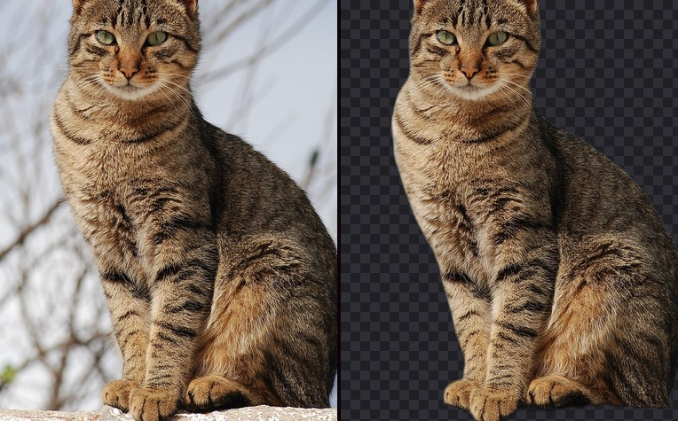

# remove bg from the right-click menu

Adds **Remove Background** to the Windows right-click menu for image files, with a submenu
of three quality settings. Right click a photo, pick one, and a cut-out PNG appears next to
it. No window, no app to open.

## install

Download `RemoveBG.zip` from the releases, unzip it, double click `install.bat`. No admin
needed. It copies itself to `%LOCALAPPDATA%\RemoveBG` and adds the menu entries for jpg,
jpeg, png, bmp, gif, webp, tif, tiff, heic, heif and avif.

**There is no Python requirement any more.** The worker ships as a PyInstaller build with
the runtime inside it, so the only thing a machine needs is Windows 10 or 11, 64-bit. The
old `RemoveBG-Setup.bat` wanted a compatible Python already installed and pulled 400 MB of
wheels at install time; this does neither.

Then right click any image: **Remove Background > Fast / Balanced / HQ**. On Windows 11
that lives under **Show more options**.

Uninstall with `uninstall.bat` in the install folder.

## the three settings

| menu item | model | size on disk | what it is good at |
|---|---|---|---|
| Fast | u2netp | 4.6 MB | about a second, fine for hard edges and graphics, mushy on fur |
| Balanced | u2net | 176 MB | about five seconds, the sensible default, decent on fur |
| HQ | bria-rmbg 2.0 | 1.02 GB | about half a minute, best on fluffy animals and hair |

The first use of each setting downloads its model, so it needs internet once per setting,
with a progress window so it never looks hung. Models live in `%USERPROFILE%\.rembg`, the
same place rembg has always put them, so an existing download is reused. Output is
`<originalname>_bgremoved.png` next to the source file, and it never overwrites a previous
cut-out: a second run makes `_bgremoved (2).png`.

If something fails you get one error dialog with a code (`RBG-W20` and so on) and the details
go to `removebg.log` in the install folder. `removebg.exe --verify` checks an install end to
end and writes `verify.txt`.

## how it is built

- `remove_bg.py` is the whole tool: the worker, plus `--install`, `--uninstall`, `--verify`
  and `--warm` modes. It locates its own folder, so the install can live anywhere.
- The model is run straight through onnxruntime, using the same normalise and mask maths as
  rembg's own session classes. That means no `rembg` package, and so no `pymatting`, scipy,
  scikit-image, numba or llvmlite, which is roughly 430 MB of dependencies that a cut-out
  does not need. The install is 143 MB on disk and 52 MB zipped, and about 120 MB of that is
  onnxruntime, numpy and numpy's bundled BLAS.
- `build_installer.py` runs PyInstaller (onedir, windowed, `pillow_heif` collected whole for
  heic support) and zips the result with `install.bat`, `uninstall.bat` and `README.txt`.
  Rebuild with `python build_installer.py`.

Registry entries go under `HKCU\Software\Classes\SystemFileAssociations\.<ext>\shell\RemoveBG`
so no elevation is involved and nothing is changed system-wide. The `.reg` is written as
UTF-16LE, because writing it in the machine's ANSI codepage breaks on a user name with
characters outside it.

Two behaviours worth knowing: a per-user lock file means three quick right-clicks queue
instead of loading three models at once, and inference only ever runs on CPU.

## credits

Windows 10 and 11, 64-bit, nothing else. Models come from
[rembg](https://github.com/danielgatis/rembg), which is MIT licensed; the heic reader is
`pillow-heif`.

Demo photo by Alvesgaspar, CC BY-SA 3.0, via Wikimedia Commons.
